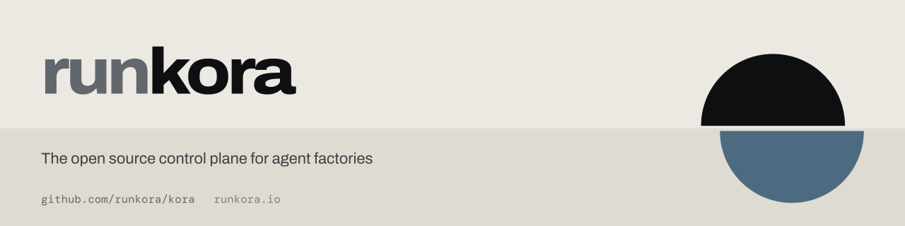
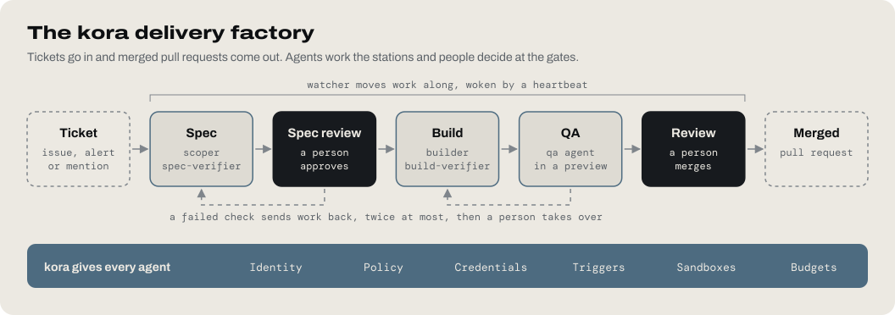
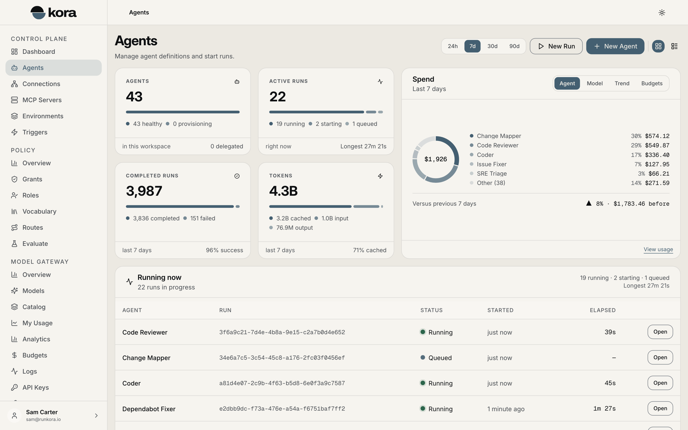

<picture>
  <source media="(prefers-color-scheme: dark)"
          srcset="/assets/banner-dark.svg">
  
</picture>

  <b>runkora</b> runs software factories on your own Kubernetes cluster.

  <a href="https://github.com/runkora/kora">kora</a> ·
  <a href="https://github.com/runkora/examples/tree/main/quickstart">quickstart</a> ·
  <a href="https://github.com/runkora/examples">examples</a> ·
  <a href="https://github.com/runkora/kora/blob/main/docs/guides/deployment.md">deployment</a> ·
  <a href="https://github.com/runkora/kora/blob/main/ARCHITECTURE.md">architecture</a> ·
  <a href="https://runkora.dev">docs</a> ·
  <a href="https://runkora.io">website</a> ·
  <a href="https://runkora.io/discord">discord</a> ·
  <a href="mailto:hello@runkora.io">contact</a>

Every agent use case you might want to ship comes down to:

* **How does an agent run?**
* **Who is the agent?**
* **What stops it from doing damage?**
* **What can it talk to?**

An agent on a laptop runs with its developer's credentials and leaves no audit trail of what it did. runkora makes those agents safe to run at scale. It is not an agent framework, a model router, or an LLM wrapper. It runs the agent harnesses you already use, such as Claude Code, Codex and OpenCode, on Kubernetes, and governs everything they do.

kora is built by a software factory that runs on kora. Its agents open pull requests and review them in [runkora/kora](https://github.com/runkora/kora) as `runkora[bot]`. See [the pull requests the factory has merged](https://github.com/runkora/kora/pulls?q=is%3Apr+is%3Amerged+author%3Aapp%2Frunkora) and [the ones it has reviewed](https://github.com/runkora/kora/pulls?q=is%3Apr+reviewed-by%3Aapp%2Frunkora).

<picture>
  <source media="(prefers-color-scheme: dark)" srcset="/assets/factory-dark.svg">
  
</picture>

<picture>
  <source media="(prefers-color-scheme: dark)" srcset="/assets/console-dark.png">
  
</picture>

## What teams build on runkora

* Review and context agents that take part in every pull request.
* Fleet-wide changes shipped as the same pull request to every team.
* Incident agents that triage an alert and start root cause analysis before anyone is paged.
* Bug-hunting agents that run weekly and explore your applications and codebases.
* General purpose coding agents that pick up work from your task or issue boards.
